# 🏆 Moby Family 360° — Экосистема Семейного Банкинга МТБанка

<div align="center">

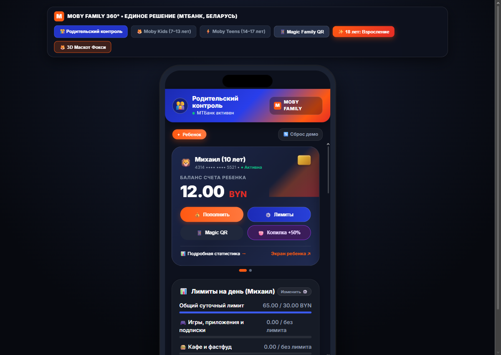

[](https://pages.github.com/)
[](LICENSE)
[-orange?style=for-the-badge&logo=javascript)](https://developer.mozilla.org/ru/docs/Web/JavaScript)
[](https://modelviewer.dev/)
[](https://www.mtbank.by/)

**Инновационная экосистема детского, подросткового и родительского банкинга нового поколения для ЗАО «МТБанк»**

[🚀 Быстрый старт](#-быстрый-запуск-за-1-клик) • [📱 Авторизация и роли](#-портал-авторизации-и-ролевая-модель) • [✨ Ключевые возможности](#-ключевой-функционал-экосистемы) • [🌐 Деплой на GitHub Pages](#-деплой-на-github-pages) • [⚖️ Законодательство РБ](#-соответствие-законодательству-республики-беларусь)

</div>

---

## 📌 О Проекте

**Moby Family 360°** — это комплексный цифровой продукт, объединяющий родителей, детей (7–13 лет) и подростков (14–17 лет) в едином финансовом пространстве. Проект решает ключевые вызовы современного финтеха:
1. **Безопасное взросление**: от первой карманной карты с 3D-маскотом до взрослого необанка в 18 лет с конверсией >85%.
2. **Финансовая грамотность через геймификацию**: интерактивный 3D-маскот Фокси, обучающие квизы в формате Duolingo со стриками и игра «Ловец бонусов».
3. **Психологический баланс в семье**: родитель сохраняет полный контроль над рисками (умные лимиты, антифрод-заморозка, софинансирование копилок), а ребенок и подросток получают уважение к личным границам и мотивацию к труду.
4. **100% готовность к деплою на GitHub Pages**: автономный реактивный клиентский движок на чистом JavaScript без необходимости аренды серверов и настройки баз данных.

---

## 📱 Портал Авторизации и Ролевая Модель

Приложение открывается с **единого портала авторизации (`index.html`)** с поддержкой ввода ПИН-кода:

| Роль | Страница | ПИН по умолчанию | Описание и сценарии использования |
| :--- | :--- | :---: | :--- |
| 👨‍👩‍👧 **Родитель** | [`parent.html`](parent.html) | **`1111`** | Управление лимитами, запрет категорий, антифрод-контроль, подтверждение SOS-запросов, софинансирование копилок (+50%) и назначение платных поручений. |
| 🦁 **Ребенок 7–13 лет** | [`kids.html`](kids.html) | **`1111`** | **Михаил (10 лет)**. Интерактивный 3D-маскот Фокси в анфас, мини-игра «Ловец бонусов» (лимит 3/день), квизы с родительской выплатой, Белкарт Pay и SOS-помощь. |
| ⚡ **Подросток 14–17 лет** | [`teens.html`](teens.html) | **`1111`** | **Алина (16 лет)**. Темный кибер-интерфейс, P2P переводы, двойные лимиты, антидропперство (ст. 222 УК РБ), налог на профдоход (НПД) и подготовка к 18 годам. |

> 💡 **Быстрый вход для жюри**: на экране ввода ПИН-кода есть кнопка **«⚡ Войти с паролем 1111»**, позволяющая мгновенно войти в нужный кабинет в 1 клик.  
> 🔄 **Смена роли**: в правом верхнем углу каждого кабинета закреплена кнопка **«🔄 Сменить роль»**, возвращающая на портал без сброса накоплений и балансов.

---

## 📸 Галерея Экранов

<div align="center">

### 👨‍👩‍👧 1. Кабинет Родителя (Moby Family Control)
| Главная панель и карты семьи | Умные суточные и категорийные лимиты | Детальный профиль и Копилка +50% |
|:---:|:---:|:---:|
|  | 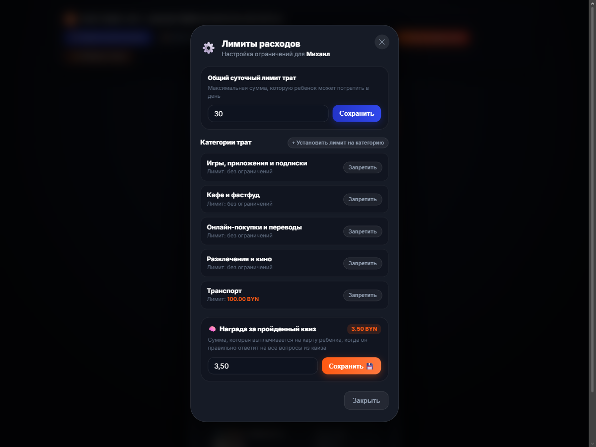 | 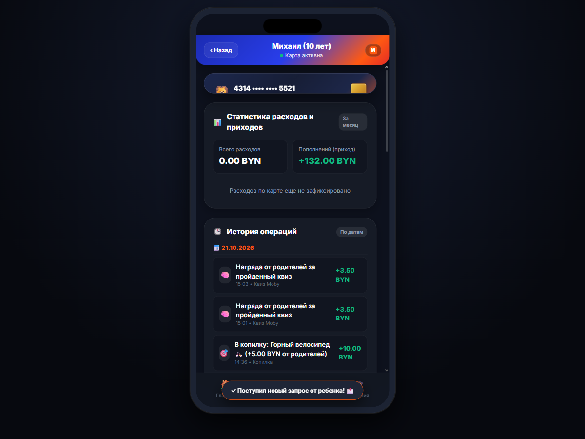 |

### 🦁 2. Кабинет Ребенка 7–13 лет (Moby Kids)
| 3D-Маскот Фокси в анфас | Финансовые советы Фокси | Мини-игра «Ловец бонусов» (3 в день) |
|:---:|:---:|:---:|
| 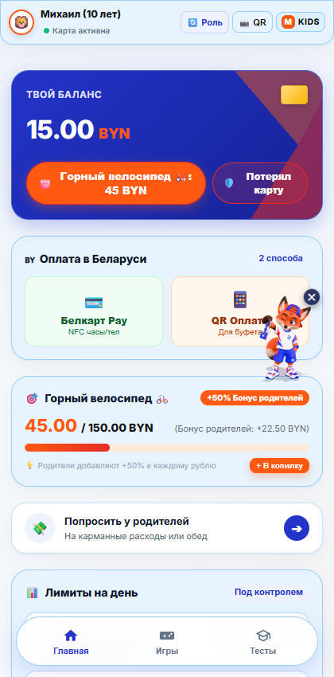 | 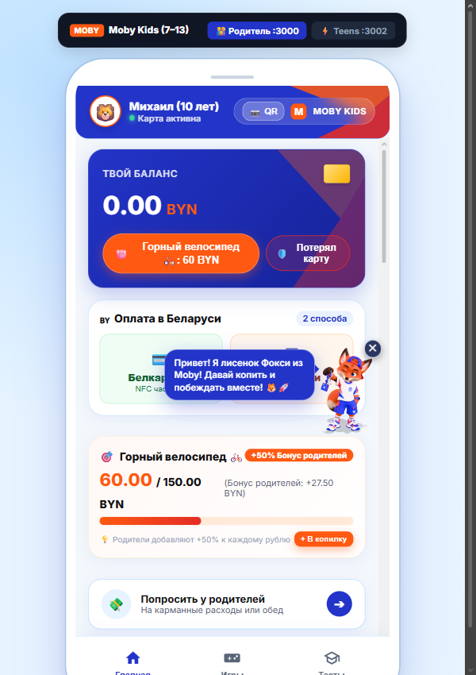 | 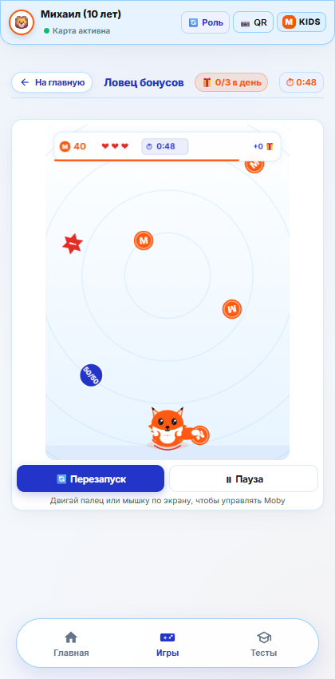 |

| Компактное окно победы игры | Moby Quiz Hub со стриками | Выплата награды от родителей за квиз |
|:---:|:---:|:---:|
| 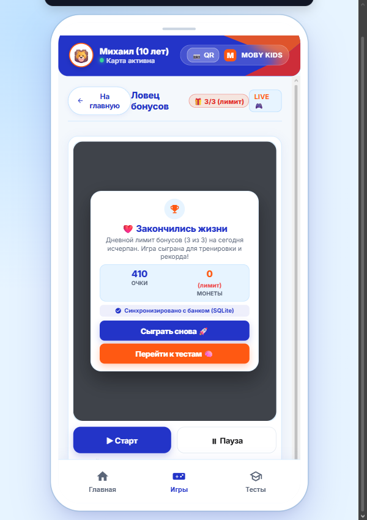 | 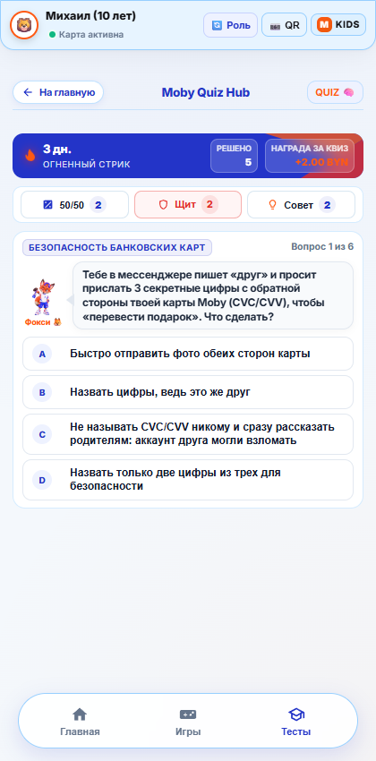 | 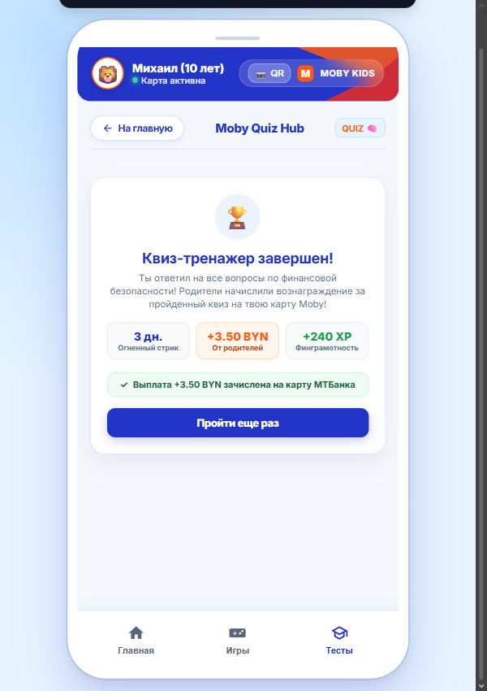 |

### ⚡ 3. Кабинет Подростка 14–17 лет (Moby Teens)
| Кибер-необанк Moby Teens | Подростковая игра и реакция | Тренажер антидропперства и финбезопасности |
|:---:|:---:|:---:|
| 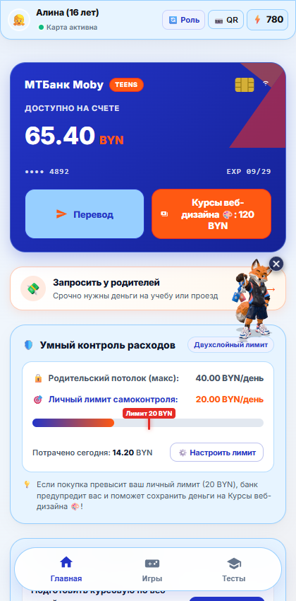 | 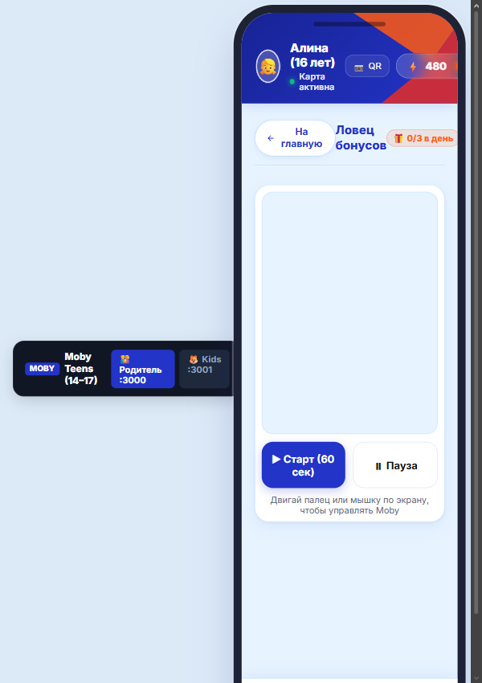 | 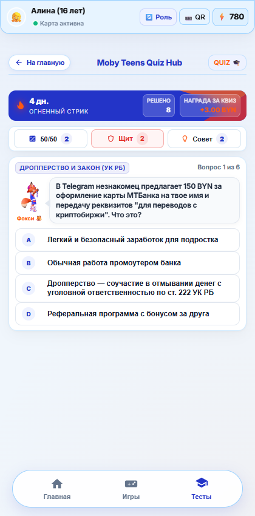 |

</div>

---

## ✨ Ключевой Функционал Экосистемы

### 1. 🦊 Интерактивный 3D-маскот Фокси в анфас
- В интерфейсе ребенка интегрирована оптимизированная 3D-модель лисенка Фокси в фирменном бомбере МТБанка (`fox.glb`), развернутая лицом к пользователю (в анфас).
- Работает на локальном движке WebGL Google `<model-viewer>` без необходимости подключения к внешним CDN.
- При клике маскот реагирует анимацией и дает полезные финансовые советы через анимированный спич-бабл.

### 2. 🎮 Мини-игра «Ловец бонусов» с суточным лимитом (3 в день)
- HTML5 Canvas 2D аркада: ребенок ловит падающие монеты, кристаллы МТБанка и щиты, избегая бомб-транжир.
- **Ограничение азарта**: за день можно получить максимум **3 бонусных набора** (`🎁 0/3 в день`). После исчерпания лимита игра остается доступной для тренировки, но начисление призов блокируется до следующего дня.

### 3. 🧠 Обучающие квизы со стриками и настраиваемой выплатой
- **Настройка награды родителем**: родитель в настройках лимитов сам задает точную сумму (например, 2.00 BYN, 3.50 BYN или 5.00 BYN), которая выплачивается за успешное решение теста.
- **Дисциплина выплаты**: деньги зачисляются на карту только при правильном ответе на **все вопросы** темы квиза.
- **Ежедневный стрик**: счетчик ударного режима (🔥 Огненный стрик) увеличивается **строго 1 раз в сутки** при полном прохождении, стимулируя ежедневное обучение финансовой грамотности.

### 4. 🐷 Копилка мечты с родительским софинансированием (+50%)
- На каждый рубль, отложенный ребенком в копилку, родитель автоматически добавляет бонус (по умолчанию +50%).
- Ребенок наглядно видит вклад родителей в его мечту (велосипед, курсы веб-дизайна), что мотивирует сохранять средства.

### 5. 🛡️ Незаметный скоринг антифрода (1–100)
- Фоновый алгоритм анализирует каждую покупку:
  - Сумма $\ge 25.00$ BYN $\rightarrow$ резкий рост риска.
  - Подозрительные онлайн-категории (донаты, иностранные подписки).
- При превышении порога операция **замораживается**, и родителю отправляется пуш с запросом подтверждения.

### 6. 💼 Подростковый банкинг и антидропперство (14–17 лет)
- **Защита по ст. 222 УК РБ**: интерактивный блок обучает распознавать схемы вербовки дропперов и отказываться от передачи карт третьим лицам.
- **Легальный фриланс (НПД)**: инструкция по официальной работе в IT и дизайне с 14 лет с уплатой 10% налога на профдоход через приложение МНС.
- **Бесшовный мост в 18 лет**: при наступлении совершеннолетия накопления, история и рейтинг Moby Score автоматически конвертируются в персональный взрослый счет IBAN с картой «Шчодрая».

---

## 🏗️ Архитектура и Реактивный Движок

Приложение построено по принципу **Serverless Reactive SPA**:
- **`moby_storage.js`** — клиентское ядро управления состоянием:
  - Инициализирует и версионирует базу данных в `localStorage` (карты родителей, профили детей, лимиты, задачи, транзакции, инвентарь и квизы).
  - Перехватывает нативные вызовы `window.fetch`, возвращая валидные ответы `Response`, как настоящий бэкенд.
  - Синхронизирует соседние вкладки через `CustomEvent('moby_storage_updated')` и `window.addEventListener('storage')`.
- **Никаких сторонних рантаймов и батников**: 100% чистый статический веб-проект, моментально открывающийся на GitHub Pages или любом веб-сервере.

---

## 🚀 Быстрый Запуск

### Способ 1. Онлайн через GitHub Pages
Просто откройте публичную ссылку развернутого репозитория — всё работает автономно без серверной части.

### Способ 2. Локально на компьютере
Откройте файл **`index.html`** в любом современном браузере или запустите любой локальный статический сервер:
```bash
# Python (если установлен):
python -m http.server 3000

# Либо через расширение VS Code: "Live Server"
```
Откройте в браузере: **`http://localhost:3000`** или локальный файл `index.html`.

---

## 🌐 Деплой на GitHub Pages

Репозиторий готов к публикации на GitHub Pages «из коробки»:

1. **Создайте новый репозиторий на GitHub** (например, `moby-family-mtbank`).
2. **Отправьте код в ветку `main`**:
   ```bash
   git add .
   git commit -m "feat: production release of Moby Family 360"
   git branch -M main
   git remote add origin https://github.com/<ВАШ_АККАУНТ>/moby-family-mtbank.git
   git push -u origin main
   ```
3. **Включите GitHub Pages**:
   - Перейдите в **Settings** $\rightarrow$ **Pages** репозитория.
   - В выпадающем списке **Source** выберите: `Deploy from a branch`.
   - В выпадающем списке **Branch**: выберите `main` и папку `/ (root)`.
   - Нажмите **Save**.
4. Через 30–60 секунд сайт будет доступен всему миру по адресу:  
   `https://<ВАШ_АККАУНТ>.github.io/moby-family-mtbank/`

---

## ⚖️ Соответствие Законодательству Республики Беларусь

Экосистема Moby Family 360° разработана в строгом соответствии с нормативно-правовой базой Республики Беларусь:

1. **Статья 27 Гражданского кодекса РБ («Дееспособность малолетних до 14 лет»)**:
   - Дети от 7 до 13 лет совершают только мелкие бытовые сделки. Дополнительная детская карта привязана к счету родителя, и юридическую ответственность несет законный представитель.
2. **Статья 25 Гражданского кодекса РБ («Дееспособность несовершеннолетних от 14 до 18 лет»)**:
   - Подростки с 14 лет вправе иметь самостоятельный заработок и счет с согласия родителей. Реализована модель двойных лимитов (родительский лимит безопасности + личный лимит самоконтроля подростка).
3. **Статья 137 Банковского кодекса РБ**:
   - Регулирует порядок открытия текущих банковских счетов физическим лицам и выпуска платежных карточек БЕЛКАРТ / Mastercard / Visa.
4. **Статья 222 Уголовного кодекса РБ («Незаконный оборот средств платежа»)**:
   - В кабинет подростка встроен антидропперский образовательный фильтр, защищающий несовершеннолетних от вовлечения в мошеннические схемы обналичивания.

---

## 📁 Структура Файлов Проекта

```
MTBHackaton/
├── index.html              # 🚪 Главный портал входа с выбором роли и ПИН-авторизацией
├── moby_storage.js         # ⚡ Клиентский реактивный движок данных и перехватчик API
├── parent.html             # 👨‍👩‍👧 Кабинет Родителя (лимиты, софинансирование, антифрод, задачи)
├── parent_app.js           # Логика родительского кабинета
├── parent.css              # Стили родительского интерфейса
├── kids.html               # 🦁 Кабинет Ребенка 7–13 лет (баланс, Белкарт Pay, копилка)
├── kids_app.js             # Логика детского кабинета
├── kids_game.js            # 🎮 Canvas мини-игра «Ловец бонусов» (лимит 3 в день)
├── kids_quiz.js            # 🧠 Квиз-тренажер Duolingo со стриками и наградами
├── kids.css                # Стили детского интерфейса (Neo-Brutalism & Glassmorphism)
├── teens.html              # ⚡ Кабинет Подростка 14–17 лет (Cyber-Dark, P2P, НПД)
├── teens_app.js            # Логика подросткового кабинета
├── teens_game.js           # Подростковая кибер-игра
├── teens_quiz.js           # Подростковый квиз по финбезопасности и дропперству
├── teens.css               # Стили подросткового интерфейса (Neon Cyberpunk)
├── model-viewer.min.js     # 🧊 Автономная библиотека WebGL для 3D-моделей (Google)
├── fox.glb                 # 🦊 3D-маскот Лисёнок в форме МТБанка (для детей 7–13 лет)
├── fox_teen.glb            # 🦊 3D-маскот Фокси-подросток с анимацией Idle_Sway (для 14–17 лет)
├── .gitignore              # Исключения для Git
├── screenshots/            # 📸 Скриншоты высокого разрешения для документации
└── README.md               # 📖 Полное руководство пользователя и разработчика
```

---

## 👥 Команда Проекта

Разработано специально для **Хакатона ЗАО «МТБанк» 2026 (г. Минск)** командой **Moby Family 360°**.

<div align="center">
  <sub>© 2026 ЗАО «МТБанк» • Проект Moby Family 360°. Все права защищены.</sub>
</div>
